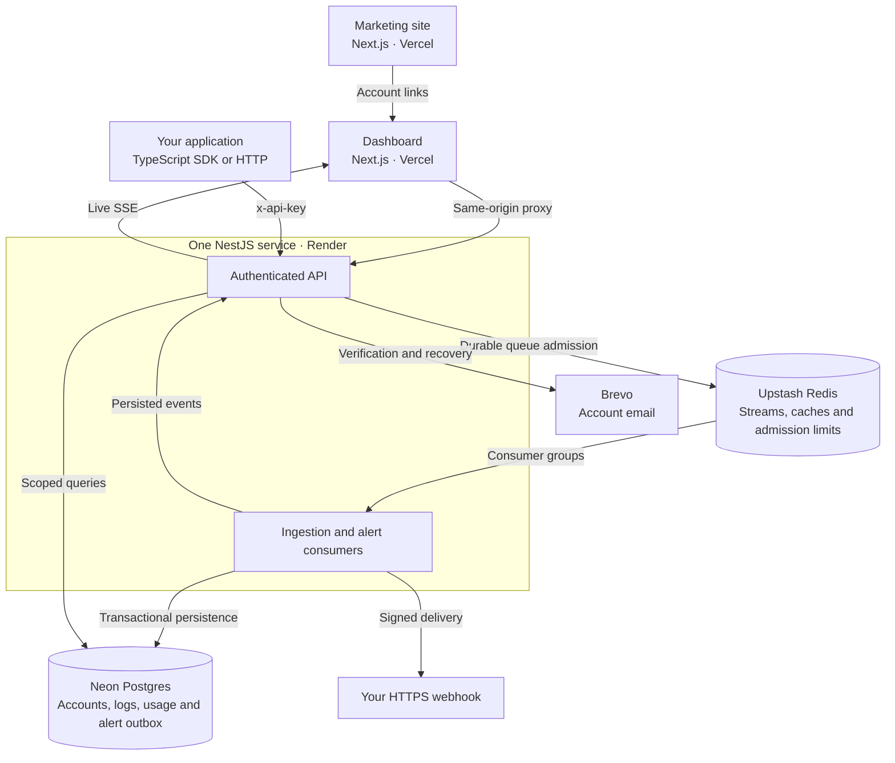

<div align="center">

# Tracebloom

**Structured logs. Live visibility. Actionable alerts.**

A cloud-backed logging platform for understanding application behavior, investigating failures, and responding to the events that matter.


<br />
<br />

[Overview](#overview) &nbsp; | &nbsp; [Architecture](#architecture) &nbsp; | &nbsp; [Getting started](#getting-started) &nbsp; | &nbsp; [SDK](#sdk-integration) &nbsp; | &nbsp; [Documentation](#documentation)

</div>

---

## Overview

Tracebloom brings application logs into a single workspace: send structured events, follow them live, search recent history, and configure webhook alerts. Personal accounts include the complete feature set, with transparent usage limits and no payments.

Built as a full-stack portfolio project, Tracebloom emphasizes the engineering behind the product: durable queue admission, idempotent processing, transactional persistence, tenant isolation, and recovery after interrupted work.

> **Project status:** The application is implemented and has been verified against cloud Neon and Upstash resources. Public hosting and live account-email delivery remain deployment steps. See the [implementation status](docs/PROGRESS.md) for the recorded verification results.

## Features

- **Live log streaming** — Follow persisted events through authenticated server-sent events, with history on connection and event deduplication on reconnect.
- **Searchable history** — Filter logs by application, environment, type, message, and time range.
- **Rule-based alerts** — Define event conditions, thresholds, and cooldowns; receive signed HTTPS webhook notifications.
- **Credential management** — Issue individual API keys and revoke them without invalidating other active credentials.
- **Account authentication** — Email verification, password recovery, short-lived access JWTs, and rotating refresh tokens.
- **Usage controls** — View daily consumption and remaining allowance; enforce account and platform limits before admitting work.
- **TypeScript integration** — Send events through a batching SDK with bounded buffering, finite retries, and explicit flush/shutdown methods.

## Architecture



The two frontend applications deploy independently. The API and asynchronous consumers share one process, keeping the deployment small while retaining a durable processing boundary.

### Processing model

1. **Authenticate and admit.** Validate identity and payload, then atomically check quotas, detect duplicate batches, and append accepted work to Redis Streams.
2. **Persist consistently.** A consumer writes the batch marker, log events, daily usage, and alert outbox in one Postgres transaction.
3. **Publish and acknowledge.** Publish alert work from the committed outbox before acknowledging ingestion. Pending entries can be recovered after a process interruption.
4. **Evaluate and deliver.** Evaluate alert rules, apply thresholds and cooldowns, and persist completed webhook deliveries.

An ingestion acknowledgement confirms that a batch was queued; persistence and alert evaluation happen asynchronously. Webhooks use at-least-once delivery, so receivers should deduplicate by `event_id`.

### Security boundaries

Passwords use Argon2id; stored refresh tokens and API keys are hashed. Dashboard credentials live in HttpOnly cookies, with Secure enabled in production, while backend requests are authenticated independently. Log, usage, key, and alert queries are scoped to the authenticated account. Webhook destinations are restricted to public HTTPS addresses, with DNS pinning and redirect rejection.

## Technology

| Layer | Implementation |
| --- | --- |
| Frontend | Next.js 16, React 19, Tailwind CSS 4 |
| API | NestJS 11, TypeScript, Node.js 22 |
| Persistence | Neon Postgres, Drizzle ORM |
| Queue and cache | Upstash Redis Streams |
| Authentication | First-party JWT authentication, Argon2id, refresh-token rotation |
| Transactional email | Brevo HTTP API |
| Hosting configuration | Vercel Hobby and Render Free |

## Getting started

### Prerequisites

- Node.js **22.x** and npm.
- A Neon Postgres database and an Upstash Redis database.
- A Brevo API key and verified sender for account verification and password recovery.

Application processes run locally during development; data services remain in the cloud. Keep Upstash eviction disabled so queued work is retained.

### 1. Install dependencies

Run from the repository root. Build the SDK before installing and building the dashboard that consumes it.

```sh
npm --prefix services ci
npm --prefix sdks/tracebloom-next ci
npm --prefix sdks/tracebloom-next run build
npm --prefix apps/main-dashboard ci
npm --prefix apps/landing-page ci
```

### 2. Configure the environment

Create each local environment file from its component template:

| Component | Template | Local file |
| --- | --- | --- |
| API | [services/.env.example](services/.env.example) | `services/.env` |
| Dashboard | [apps/main-dashboard/.env.example](apps/main-dashboard/.env.example) | `apps/main-dashboard/.env.local` |
| Marketing | [apps/landing-page/.env.example](apps/landing-page/.env.example) | `apps/landing-page/.env.local` |
| SDK consumer | [sdks/tracebloom-next/.env.example](sdks/tracebloom-next/.env.example) | Your application's server environment |

The root [.env.example](.env.example) documents the complete configuration; it is a reference rather than a shared file loaded by every application.

Configure Neon's pooled runtime URL and direct schema-management URL, Upstash credentials, and Brevo credentials. Generate separate values for `JWT_SECRET`, `REDIS_KEY_SECRET`, and `WEBHOOK_SIGNING_SECRET` by running this command once per secret:

```sh
node -e "console.log(require('node:crypto').randomBytes(48).toString('hex'))"
```

Set API `APP_URL` and `FRONTEND_ORIGINS` to the dashboard origin. Set dashboard `SERVER_URI` to the API base URL, including `/api/v1`, and marketing `NEXT_PUBLIC_DASHBOARD_URL` to the dashboard origin. Keep provider credentials, signing secrets, and SDK keys in server environments.

### 3. Initialize the database

Apply the schema to the fresh cloud database configured above:

```sh
npm --prefix services run db:push
```

### 4. Run the applications

Start each process in a separate terminal:

```sh
# API
npm --prefix services run start:dev

# Dashboard
npm --prefix apps/main-dashboard run dev -- --port 3001

# Marketing
npm --prefix apps/landing-page run dev -- --port 3000
```

Open the [dashboard](http://localhost:3001) to create an account, verify your email, and generate an API key. The [marketing site](http://localhost:3000) runs separately, and API health is available at [localhost:8080/api/v1/health](http://localhost:8080/api/v1/health).

## SDK integration

The `@tracebloom/next` package supports server-side TypeScript applications. It currently ships in this repository and has not been published to npm. After building it, install the local package from your application's directory:

```sh
npm install /absolute/path/to/tracebloom/sdks/tracebloom-next
```

Load the [SDK environment variables](sdks/tracebloom-next/.env.example) in your application's server runtime, then create a logger:

```ts
import { createLogger } from "@tracebloom/next";

const log = createLogger({
  apiKey: process.env.TRACEBLOOM_API_KEY!,
  baseUrl: process.env.TRACEBLOOM_SERVER_URI!, // API URL including /api/v1
  appName: "orders-api",
  environment: process.env.NODE_ENV,
  onError: (error, { dropped }) => {
    console.error("Log delivery failed", {
      message: error.message,
      dropped,
    });
  },
});

log.info("Order received", { order_id: "order_1042" });
log.error("Inventory lookup failed", { importance: "critical" });

await log.flush(); // Await before a short-lived request or job exits.
```

Use `await log.close()` when a long-running process shuts down. The SDK keeps batch IDs stable across retries and reports events it cannot deliver through `onError`.

<details>
<summary><strong>Send events over HTTP</strong></summary>

Any server-side application can POST to `/api/v1/logs/send` with `Content-Type: application/json` and an `x-api-key` header:

```json
{
  "batchId": "54bb0f96-e3e0-4fe1-8db6-dc4d00d580f4",
  "logs": [
    {
      "type": "info",
      "app_name": "orders-api",
      "environment": "development",
      "message": "Order received"
    }
  ]
}
```

Reuse the batch ID and payload when retrying that batch. Use a new batch ID for new events.

</details>

## Resource limits

| Resource | Default allowance |
| --- | --- |
| Events per account | 1,000 per UTC day |
| Log retention | 7 days from server receipt |
| Active API keys | 3 per account |
| Active alert rules | 3 per account |
| Batch size | 100 events |
| Payload size | 8 KiB per event; 256 KiB of log data per batch |

Shared platform ceilings also bound daily events, batches, bytes, and outstanding queue work. These are configured in the [API environment template](services/.env.example). Cold starts, provider limits, and retries can delay availability; this deployment targets a bounded hobby service.

## Development and verification

Run the following from the repository root:

| Check | Command |
| --- | --- |
| SDK tests | `npm --prefix sdks/tracebloom-next test` |
| Service typecheck | `npm --prefix services run typecheck` |
| Service build and tests | `npm --prefix services test` |
| Dashboard production build | `npm --prefix apps/main-dashboard run build` |
| Marketing production build | `npm --prefix apps/landing-page run build` |
| Cloud integration suite | `npm --prefix services run test:cloud` |

The cloud suite requires a running API with Neon and Upstash credentials. It creates and removes disposable fixtures, exercises real persistence and queue recovery, and substitutes email/webhook delivery so no external messages are sent.

Set `OML_SMOKE_DASHBOARD_URL` to a running dashboard to include browser checks; `OML_SMOKE_LANDING_URL` adds marketing checks. Browser verification requires Python Playwright and Chromium, with system Chrome/Edge supported. See the [operations guide](docs/README.md) and [recorded results](docs/PROGRESS.md) for details.

## Deployment

| Component | Target | Configuration |
| --- | --- | --- |
| API and consumers | Render Free | [render.yaml](render.yaml); root `services` |
| Dashboard | Vercel Hobby | [vercel.json](apps/main-dashboard/vercel.json); root `apps/main-dashboard` |
| Marketing | Vercel Hobby | [vercel.json](apps/landing-page/vercel.json); root `apps/landing-page` |

Enable access to source outside the dashboard's Vercel root for its local SDK dependency. Apply the Neon schema, configure each component's environment, and connect the API and frontend URLs. Provider-assigned HTTPS URLs are sufficient; a custom domain is optional.

Deployment manifests are prepared. Complete hosted rollout and verify actual Brevo signup/recovery delivery before opening registration. The [operations guide](docs/README.md) covers environment wiring and deployment considerations.

## Project structure

```text
apps/
  landing-page/       Marketing site
  main-dashboard/     Product UI and authenticated API proxies
services/             NestJS API and asynchronous consumers
sdks/
  tracebloom-next/     TypeScript SDK
docs/                 Specifications, operations and engineering notes
.env.example          Workspace configuration reference
render.yaml           API deployment blueprint
```

## Documentation

| Document | Purpose |
| --- | --- |
| [Operations guide](docs/README.md) | Setup, configuration, verification, and deployment |
| [Product specification](docs/SPECS_AND_EPICS.md) | Scope, architecture decisions, and acceptance boundaries |
| [Engineering instructions](docs/AGENTS.md) | Repository conventions and invariants |
| [Implementation status](docs/PROGRESS.md) | Implemented capabilities and recorded verification |
| [Environment reset report](docs/RESET_REPORT.md) | Legacy infrastructure cleanup and resource boundaries |
